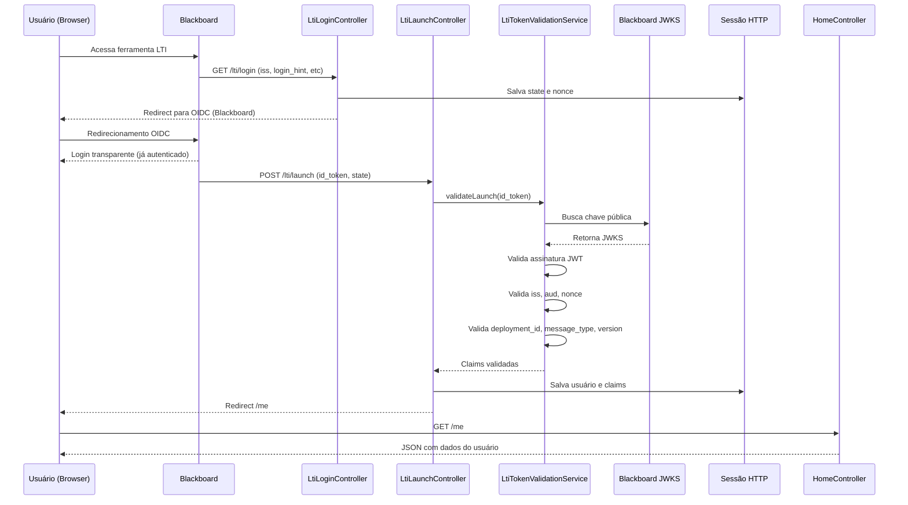

# LTI 1.3 com Spring Boot — Integração com Blackboard


## 📌 Visão geral

Esta aplicação implementa uma integração **LTI 1.3 (Learning Tools Interoperability)** com o **Blackboard Learn**, utilizando **Spring Boot**.

O objetivo é permitir autenticação via Blackboard, eliminando login próprio e aproveitando o contexto acadêmico do usuário para autenticação e integração com futuras aplicações.

---

## 🎯 Objetivo

Este projeto foi criado para servir como base de autenticação via **LTI 1.3**, permitindo que aplicações internas utilizem o Blackboard como provedor de identidade.

### Cenário resolvido

1. o usuário acessa a ferramenta pelo Blackboard;
2. o Blackboard autentica o usuário;
3. a aplicação recebe um `id_token` assinado;
4. o token é validado com segurança;
5. os dados do usuário são extraídos e disponibilizados para uso da aplicação.

---

## 🚀 Funcionalidades

- Login via **LTI 1.3 (OIDC)**
- Validação do `id_token` (JWT)
- Par de chaves RSA carregado via variável de ambiente
- Exposição da chave pública real no endpoint **JWKS**
- Extração de dados do usuário:
    - nome
    - email
    - roles
- Armazenamento em sessão
- Endpoints para consulta e debug:
    - `/me`
    - `/lti/claims`
    - `/lti/token`

---

## 🔄 Fluxo LTI

### 1. Login Initiation

O Blackboard chama:

```http
GET /lti/login
```

A aplicação:

- recebe parâmetros como `iss`, `login_hint` e `target_link_uri`
- gera `state` e `nonce`
- salva os dados na sessão
- redireciona o navegador para o endpoint OIDC do Blackboard

### 2. Launch

O Blackboard retorna:

```http
POST /lti/launch
```

Com:

- `id_token` (JWT assinado)
- `state`

A aplicação:

- valida o token
- extrai as claims
- salva os dados do usuário na sessão
- redireciona para `/me`

### 3. Consumo

```http
GET /me
```

Retorna:

```json
{
  "name": "Usuário",
  "email": "usuario@email.com",
  "roles": [
    "http://purl.imsglobal.org/vocab/lis/v2/membership#Instructor"
  ]
}
```

---

## 🏗️ Arquitetura



---

## 🧱 Estrutura do projeto

```text
src/main/java/br/dev/fabiorvs/lti
│
├── config
│   ├── AppProperties.java
│   ├── LtiKeyProperties.java          ← novo
│   ├── LtiPlatformProperties.java
│   └── SecurityConfig.java
│
├── controller
│   ├── HomeController.java
│   ├── JwksController.java            ← atualizado
│   ├── LtiLoginController.java
│   └── LtiLaunchController.java
│
├── exception
│   ├── GlobalExceptionHandler.java
│   └── LtiValidationException.java
│
├── model
│   └── LtiUserResponse.java
│
├── service
│   ├── LtiKeyService.java             ← novo
│   └── LtiTokenValidationService.java
│
└── LtiApplication.java
```

---

## 🔐 Segurança implementada

A aplicação já valida os principais pontos de segurança do launch LTI 1.3:

- assinatura JWT usando **JWKS**
- `issuer` (`iss`)
- `audience` (`aud`)
- `state`
- `nonce`
- `issued at` (`iat`)
- `expiration` (`exp`)

### Validações adicionais LTI

Também foram adicionadas validações específicas do protocolo:

#### `deployment_id`
Garante que o launch veio da instalação correta da ferramenta.

#### `message_type`
Garante que o tipo de mensagem recebido é o esperado, como:

- `LtiResourceLinkRequest`

#### `version`
Garante que a versão do protocolo é compatível, por exemplo:

- `1.3.0`

### Par de chaves RSA

A aplicação gera e expõe sua própria chave pública no endpoint `/.well-known/jwks.json`, necessário para integrações que exigem assinatura de tokens pela ferramenta (ex: Deep Linking, AGS).

- a **chave privada** é carregada via variável de ambiente (`LTI_PRIVATE_KEY`) em formato Base64
- a **chave pública** é derivada automaticamente da privada em memória no startup
- o endpoint JWKS expõe a chave pública no formato JWK (RFC 7517)

---

## ⚙️ Configuração

### `application.yml`

```yaml
spring:
  application:
    name: lti

app:
  base-url: ${APP_BASE_URL}

lti:
  platform:
    issuer: https://blackboard.com
    client-id: ${LTI_CLIENT_ID}
    deployment-id: ${LTI_DEPLOYMENT_ID}
    jwks-url: https://developer.blackboard.com/api/v1/management/applications/${LTI_CLIENT_ID}/jwks.json
    oidc-auth-url: https://developer.blackboard.com/api/v1/gateway/oidcauth
    access-token-url: https://developer.blackboard.com/api/v1/gateway/oauth2/jwttoken
    signature-alg: RS256

  keys:
    private-key: ${LTI_PRIVATE_KEY}
    key-id: ${LTI_KEY_ID:minha-chave-v1}
```

### Variáveis de ambiente

```bash
APP_BASE_URL=https://seu-dominio-ou-ngrok
LTI_CLIENT_ID=seu-client-id
LTI_DEPLOYMENT_ID=seu-deployment-id
LTI_PRIVATE_KEY=LS0tLS1CRUdJTiBQUklWQVRFIEtFWS0tLS0t...   # chave privada RSA em Base64
LTI_KEY_ID=minha-chave-v1                                  # opcional, tem valor padrão
```

### Gerando o par de chaves RSA

```bash
# Gera a chave privada RSA 2048 bits
openssl genrsa -out lti-private.pem 2048

# Extrai a chave pública (usar para cadastro no Blackboard)
openssl rsa -in lti-private.pem -pubout -out lti-public.pem

# Converte a chave privada para Base64 single-line (usar na variável de ambiente)
base64 -w 0 lti-private.pem
```

> ⚠️ Nunca commite os arquivos `.pem` ou `.env` no repositório. Adicione-os ao `.gitignore`.

```gitignore
*.pem
*.key
.env
```

---

## 📡 Endpoints

| Método | Endpoint | Descrição |
|---|---|---|
| GET | `/` | health check simples |
| GET | `/.well-known/jwks.json` | chave pública RSA da aplicação (JWK) |
| GET | `/lti/login` | inicia o fluxo LTI/OIDC |
| POST | `/lti/launch` | recebe o launch do Blackboard |
| GET | `/me` | retorna dados do usuário autenticado |
| GET | `/lti/claims` | retorna todas as claims da sessão |
| GET | `/lti/token` | retorna o token bruto salvo na sessão |

---

## 🧠 Componentes principais

### `LtiLoginController`
Responsável por iniciar o fluxo LTI, gerar `state` e `nonce`, armazenar dados de sessão e redirecionar para o Blackboard.

### `LtiLaunchController`
Recebe o launch, valida o token, monta o usuário e salva dados na sessão.

### `LtiTokenValidationService`
Centraliza a validação de segurança do token LTI.

### `LtiKeyService`
Carrega a chave privada RSA via variável de ambiente (Base64) e deriva a chave pública em memória no startup da aplicação.

### `LtiKeyProperties`
Mapeia as propriedades `lti.keys.*` do `application.yml` para injeção tipada.

### `JwksController`
Expõe a chave pública RSA real da aplicação no endpoint `/.well-known/jwks.json` no formato JWK, consumido pelo Blackboard para verificar tokens assinados pela ferramenta.

### `HomeController`
Expõe endpoints simples para retorno dos dados autenticados.

### `SecurityConfig`
Controla o acesso às rotas da aplicação.

### `GlobalExceptionHandler`
Centraliza o tratamento de erros e padroniza respostas da API.

---

## ✅ Benefícios

### Para o negócio

- elimina login paralelo
- aproveita a autenticação do Blackboard
- reduz atrito para o usuário
- serve como base para novas integrações

### Para devs

- arquitetura simples e modular
- validação centralizada
- configuração por variáveis de ambiente
- chave RSA carregada de forma segura sem persistência em disco
- base pronta para evolução futura

---

## ⚠️ Limitações atuais

- ainda não há persistência em banco
- ainda não há autenticação formal do usuário no Spring Security após o launch
- ainda não há uso de serviços LTI Advantage, como:
    - AGS
    - NRPS
- logs ainda podem ser evoluídos para formato estruturado

---

## 🛣️ Próximos passos

- persistir usuários e launches
- autenticar usuário formalmente no Spring Security
- integrar com gradebook via **AGS**
- listar participantes via **NRPS**
- melhorar auditoria e logs
- suportar outros tipos de `message_type`, como Deep Linking

---

## ▶️ Como executar

### Ambiente local

```bash
export APP_BASE_URL=https://seu-dominio-ou-ngrok
export LTI_CLIENT_ID=seu-client-id
export LTI_DEPLOYMENT_ID=seu-deployment-id
export LTI_PRIVATE_KEY=$(base64 -w 0 lti-private.pem)

mvn spring-boot:run
```

### Usando arquivo `.env` (recomendado para desenvolvimento)

Crie um arquivo `.env` na raiz do projeto:

```env
APP_BASE_URL=https://seu-dominio-ou-ngrok
LTI_CLIENT_ID=seu-client-id
LTI_DEPLOYMENT_ID=seu-deployment-id
LTI_PRIVATE_KEY=LS0tLS1CRUdJTiBQUklWQVRFIEtFWS0tLS0t...
```

No IntelliJ, aponte para esse arquivo em **Run > Edit Configurations > Environment variables**.

### Exposição com ngrok

```bash
ngrok http 8081
```

---

## 🌐 Configuração no Blackboard

Preencha os campos da ferramenta com URLs da sua aplicação:

| Campo | Valor |
|---|---|
| Login Initiation URL | `https://SEU_DOMINIO/lti/login` |
| Tool Redirect URL(s) | `https://SEU_DOMINIO/lti/launch` |
| Tool JWKS URL | `https://SEU_DOMINIO/.well-known/jwks.json` |

> A **Tool JWKS URL** agora expõe a chave pública RSA real gerada pela aplicação.

---

## 📌 Resumo

Esta aplicação já implementa uma base sólida para autenticação **LTI 1.3 com Blackboard**, com validação de segurança do token, extração de dados do usuário, exposição de chave pública RSA via JWKS e arquitetura preparada para evolução.

Ela pode ser usada como ponto de partida para substituir logins tradicionais por autenticação via Blackboard em aplicações internas.

---

## 👨‍💻 Autor

Desenvolvido por **Fabio Roberto Vieira da Silva**

## 📄 Licença

MIT
